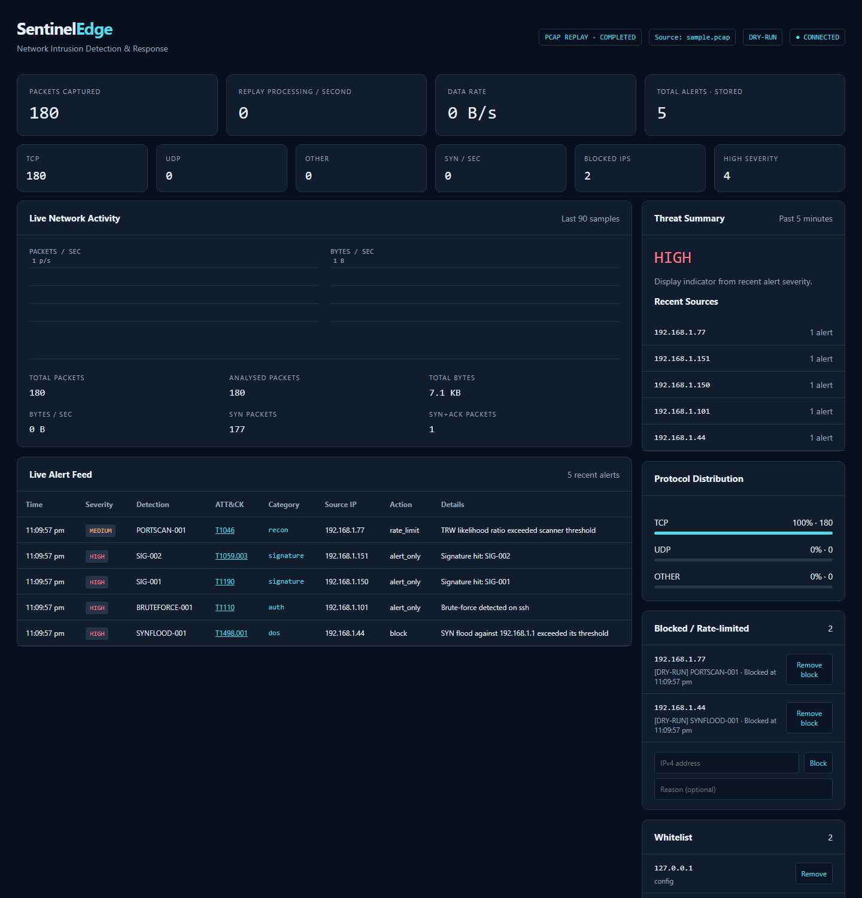
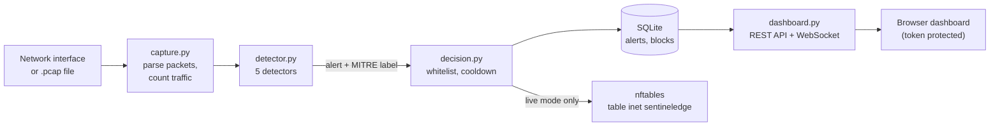
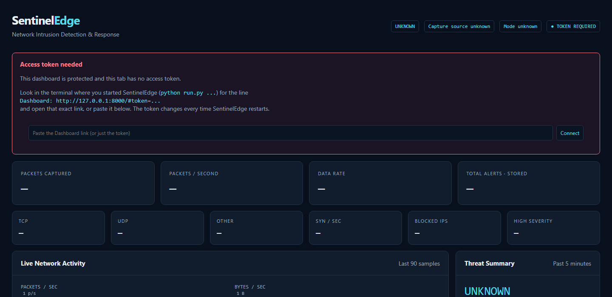

# SentinelEdge

A small network intrusion detection system (NIDS) for a lab network. It watches
packets, spots common attacks, labels them with **MITRE ATT&CK** techniques, can block
attackers with the Linux firewall (nftables), and shows everything on a live web dashboard.



**Measured results** on 15 labelled scenarios ([full report](docs/evaluation.md)):
**10 / 10 attacks detected, 0 false alarms**, compared with 8 / 10 and 105 false alarms
for the original version.

| Detects | How | MITRE ATT&CK |
|---|---|---|
| Port scans | Threshold Random Walk over first-contact TCP connection attempts | [T1046](https://attack.mitre.org/techniques/T1046/) Network Service Discovery |
| SYN floods | Per-victim SYN rate against a learned (EWMA) baseline, blaming only the dominant sources | [T1498.001](https://attack.mitre.org/techniques/T1498/001/) Direct Network Flood |
| SSH / FTP / RDP brute force | New login connections per source in sliding windows | [T1110](https://attack.mitre.org/techniques/T1110/) Brute Force |
| Data exfiltration | A host's outbound volume compared with its own 24 h baseline | [TA0010](https://attack.mitre.org/tactics/TA0010/) Exfiltration |
| Known-bad payloads | Keyword signatures (Aho-Corasick), e.g. `/etc/passwd`, `cmd.exe` | per signature, e.g. [T1190](https://attack.mitre.org/techniques/T1190/), [T1059.003](https://attack.mitre.org/techniques/T1059/003/) |

It runs in **dry-run mode by default**: it logs what it *would* block and never touches the firewall.

## How it works



Every packet is turned into a small record (addresses, ports, TCP flags, payload,
timestamp) and passed to each detector. Detectors use the **packet's own timestamp**,
so a recorded capture behaves exactly like live traffic. In plain words:

- **Port scan:** every *new* host+port a machine tries to reach is one "attempt"; the
  target's answer decides whether it succeeded (SYN-ACK) or failed (RST or silence).
  Normal users mostly succeed, scanners mostly fail, and a statistical test (TRW)
  decides once the evidence is strong enough, usually after about 4 failures.
- **SYN flood:** counts connection requests per *target* each second and compares them
  with what is normal for that target. It blames only senders responsible for at least
  20% of the flood; if no one is (spoofed or distributed attack), it warns about the
  victim instead of blocking random addresses.
- **Brute force:** logins are encrypted, so it counts *new connections* to SSH, FTP and RDP:
  6 in a minute gives a warning, 10 in five minutes a block.
- **Exfiltration:** remembers how much each internal machine normally uploads to the
  Internet (per minute, for 24 hours) and flags a sudden upload many times larger.
- **Signatures:** searches packet contents for known attack strings in one pass.

Repeated alerts for the same attacker are suppressed for 60 seconds, so one attack
produces one alert, not thousands.

## Evaluation

`evaluate.py` builds 15 labelled packet traces: 5 kinds of normal traffic (web browsing,
a long SSH session, a busy server, a LAN copy, a large download) and 10 attacks
(including attacks hidden inside normal traffic). It runs each through the real detector
and checks that attacks are reported for the right IP and that normal traffic raises nothing.

| Measure | Original version | Current |
|---|---|---|
| Attacks detected | 8 / 10 | **10 / 10** |
| Normal scenarios without false alarms | 0 / 5 | **5 / 5** |
| False alarms (wrong type or wrong IP) | 105 | **0** |
| Alerts raised in total | 8,645 | **13** |

```bash
python evaluate.py                     # current code; writes docs/evaluation.md
python evaluate.py --baseline ddb182e  # also re-runs the original commit for comparison
```

The scenarios are synthetic and small (the exfiltration threshold is scaled down to
1 MB), so they show the detectors' logic is right, not how they perform on a large real
network. A unit test runs them in CI so detection can't silently get worse.

## Quick start (Windows, macOS or Linux): replay the sample capture

Needs Python 3.10 or newer (tested with 3.13); Node.js only for the dashboard tests.

```bash
python -m venv .venv
# Windows:      .\.venv\Scripts\Activate.ps1
# macOS/Linux:  source .venv/bin/activate
python -m pip install -r requirements-test.txt

python run.py --pcap sample.pcap
```

Your browser opens the dashboard automatically. If it doesn't (or you closed it), open
the **Dashboard:** link printed in the terminal, for example
`http://127.0.0.1:8000/#token=...`. Use that exact link: plain `http://localhost:8000`
shows an "Access token needed" panel, where you can paste the link instead.


`sample.pcap` contains one of each attack, so you should see 5 alerts (port scan,
SYN flood, brute force, two signatures).

## Live capture and blocking (Linux only)

```bash
sudo .venv/bin/python run.py --iface eth0             # dry run: detect + log only
sudo .venv/bin/python run.py --iface eth0 --enforce   # detect + block attackers
```

To enforce blocks, pass `--enforce` (or set `dry_run: false` in `config.yaml`). SentinelEdge
then manages its own nftables table, `inet sentineledge`. With the shipped config every
detection blocks its source (port scan, SYN flood, brute force, signatures; exfiltration
only alerts, since its source is your own machine), and blocks are **permanent**
(`response.block_expiry_sec: 0`) until you remove them from the dashboard. Blocks are
stored in the database and restored on restart, and the sensor never blocks its own
address. Inspect it with `sudo nft list table inet sentineledge`. If nftables isn't
available, live mode refuses to start rather than running unprotected.

## The dashboard

- It listens on **127.0.0.1 only** by default. `--host 0.0.0.0` exposes it to the
  network on purpose (there is no HTTPS, so do this only on a trusted lab network).
- Every API call needs an access token. A new random one is generated each run and
  included in the printed link (old links stop working after a restart); set
  `SENTINELEDGE_TOKEN` to keep the same one.
- On a desktop session the link opens in your browser by default. `--no-browser` turns
  that off; it never happens when running as root or without a display.
- From the dashboard you can block or unblock IPs and manage the whitelist.

## Configuration (`config.yaml`)

| Section | What it controls |
|---|---|
| `capture` | Interface, PCAP file, `dry_run` |
| `alerts` | `suppress_sec` (drop repeats of the same alert), `retention_days` |
| `response` | `block_expiry_sec` for automatic blocks (0 = permanent) |
| `whitelist` | IPs that are never blocked |
| `rules` | One entry per detector: `enabled`, `params`, `severity`, `action` (`block`, `rate_limit` or `alert_only`), `mitre` |
| `signatures` | Keyword patterns with `severity` and `mitre`; each can be switched off with `enabled: false` |

Environment variables: `SENTINELEDGE_TOKEN` (dashboard token), `SENTINELEDGE_DB`
(database path; default `sentineledge.db` in the project folder).

## Running the tests

```bash
python -m unittest test_telemetry -v
node test_dashboard.cjs
```

GitHub Actions runs both on every push and pull request (`.github/workflows/tests.yml`).
See [TESTING.md](TESTING.md) for what is and isn't covered.

## Project layout

```
run.py                  entry point: wires everything together and starts the server
config.yaml             settings, rules and signatures
sentineledge/
  capture.py            reads packets (live or from a .pcap) and counts traffic
  detector.py           the five detectors
  decision.py           whitelist, cooldown, dry-run log or nftables response
  database.py           SQLite storage: alerts, blocks, whitelist
  dashboard.py          FastAPI web server, REST API and WebSocket
templates/index.html    the dashboard page
evaluate.py             labelled scenarios and the detection report
docs/evaluation.md      latest evaluation report (generated)
create_sample_pcap.py   regenerates sample.pcap
test_telemetry.py       Python tests
test_dashboard.cjs      dashboard JavaScript tests (no browser needed)
```

## Limitations

- Brute-force detection counts login *connections*; it cannot see whether a password
  was wrong (SSH and RDP are encrypted). Tools that legitimately open many SSH
  connections (e.g. Ansible) may need whitelisting.
- Floods from spoofed addresses are reported but can't usefully be blocked by IP;
  enable SYN cookies (`net.ipv4.tcp_syncookies`) on the protected host.
- The nftables integration and live capture have only been exercised with the
  firewall stubbed out, not against a real kernel in CI.
- The evaluation uses synthetic traces, not a public dataset such as CIC-IDS2017, and
  Python packet parsing limits throughput on busy links.
